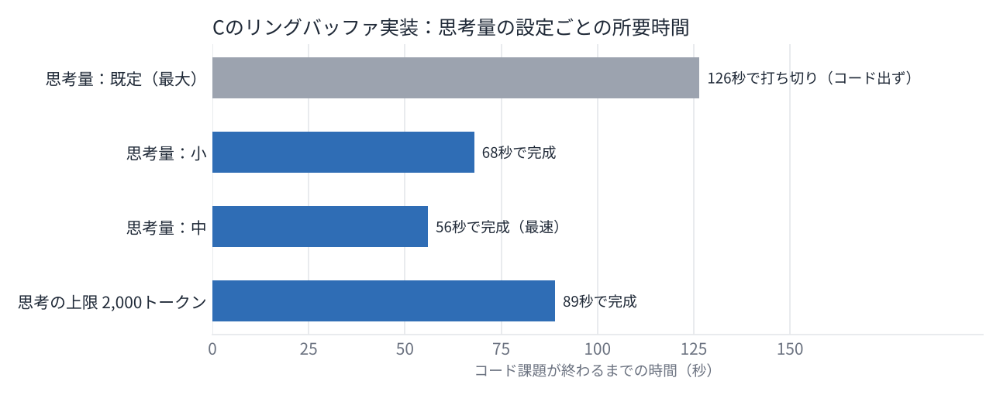
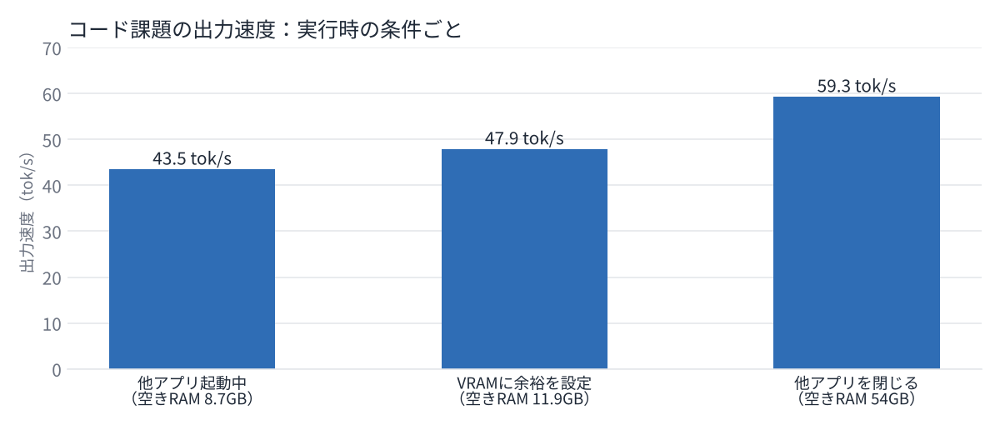
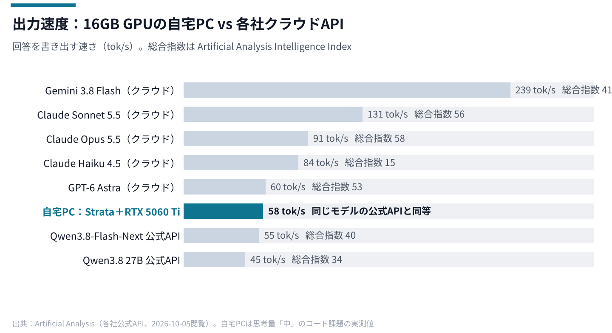

# VRAM 16GBのゲーミングPCで125BのLLMを動かした：Strata導入とベンチマークの記録

## 先に結論

VRAM 16GBのRTX 5060 Ti 1枚と64GBのメインメモリで、125BクラスのMoEモデル「Qwen3.8-Flash-Next」が出力 約58 tok/s で動いた。使ったのは、2026年9月末に公開された推論エンジン「Strata」である。これまで自分のPCで現実的に動かせたのは27B級までだったので、扱えるモデルの規模が一段上がった。

つまずいたのは速度ではなく「考えすぎ」だった。既定の設定だと、Cのコードを1つ頼んだだけでモデルが6,000トークン考え続け、2分かけてもコードが1行も出なかった。思考量を一段下げたら56秒で完成した。もう1つ効いたのはメインメモリの空きで、他のアプリを閉じただけで出力が 43 → 59 tok/s に上がった。

コードの質は「設計は的確だが凡ミスが残る」程度で、下書きとしては使える。すべてローカルで完結するので、社外に出せない情報を扱う用途で検討する価値はあると思う。


> 【要差替】Strataのチャット画面（`http://127.0.0.1:8080`）で、日本語の質問に回答している画面。個人のユーザー名やブックマークバーが写らないように切り抜く。

## Strataとは

Strataは、Qwen3.8-Flash-Next を一般のゲーミングPCで動かすための専用の推論エンジンだ。GitHubでMITライセンスで公開されている（[Niko1221/Strata](https://github.com/Niko1221/Strata)）。llama.cpp のような汎用ランタイムではなく、ほぼこのモデル専用に作り込まれている。

Qwen3.8-Flash-Next はMoE（Mixture of Experts）という作りのモデルで、本体の125Bパラメータのうち、1トークンの計算に使うのは約6Bだけである。

中身は48の層が積み重なっていて、各層に「専門家（エキスパート）」と呼ばれる小さなネットワークが512個ずつ、合計24,576個ある。各層の入口にある振り分け役（ルーター）が、そのトークンに合う専門家を512個の中から10個だけ選び、残りの502個は計算しない。

つまり、モデル全体は大きくても、1トークンごとに必要な専門家はごく一部で、しかもよく選ばれる専門家は偏っている。Strataはここに目をつけて、置き場所を分けている。自分の環境では次のようになった（数値は起動ログから）。

| 置き場所 | 置いたもの | 量（自分の環境） | 計算するのは |
| --- | --- | --- | --- |
| GPU（VRAM 16GB） | 毎トークン必ず通る部分（attention、ルーター等）＋よく選ばれる専門家 | 専門家 5,206個（全体の21%）、8.4GB | GPU |
| メインメモリ（64GB） | 専門家 24,576個すべて | 約40GB | GPUに無い専門家はCPU |
| SSD | 単語の参照表 | 28.8GB（1トークンあたり数行だけ読む） | ― |

GPUに置けた専門家は全体の2割ほどだが、実際に選ばれた専門家の73〜85%がGPU上にあった（ログの `expert cache hit rate`）。よく使われる2割で8割をまかなえるので、残りの2割前後だけをCPUがメインメモリ上で計算すればよい。GPUとCPUは同時に動くので、お互いを待たない。

速さの工夫としては、モデルに内蔵された小さな予測層（MTP）が次の数トークンを予想し、本体がまとめて検証する「投機的デコード」を使っている。最終的に決めるのは本体なので、出力の質は変わらない。公式の説明では、速さに一番効くのはGPUの演算性能ではなくVRAMの量で、VRAMが1GB増えるごとに約700個の専門家をGPUに置ける。

OpenAI互換とAnthropic互換のAPIを `127.0.0.1:8080` で出すので、既存のツールからそのままつなげる。

## 環境

| 項目 | 内容 |
| --- | --- |
| PC | マウスコンピューター DAIV（Windows 11 Home） |
| CPU | Intel Core i7-14700F（28スレッド） |
| GPU | NVIDIA GeForce RTX 5060 Ti 16GB |
| メインメモリ | DDR5 64GB |
| Strata | engine 0.1.38 |
| モデル | Qwen3.8-Flash-Next IQ3_XXS（約3ビット量子化、ダウンロード約76GB） |
| 文脈長 | 64K（GPUに置くKVキャッシュは32K分） |

## やり方

導入自体は簡単で、リポジトリを置いて `START-HERE.bat` を実行すれば、Pythonの用意、モデルのダウンロード、起動まで進む。自分の環境では、ダウンロードが約100MB/sで約12分、初回の変換を含めて全体で30分ほどだった。

1. GitHubから本家のリポジトリを取得する。同じ説明文のフォークが大量にあるので、本家（Niko1221/Strata）かどうかを確認する
2. `START-HERE.bat` を実行して、モデルの量子化（IQ3_XXS）を選ぶ
3. 起動するとブラウザでチャット画面が開く。初回の起動は、モデルをメモリに読み込む間の1〜3分、PCがほぼ固まる

毎回の操作を減らすため、ワンクリックで起動するbatとベンチ用のbatを自作した。AIへの指示はこれだけである。

```
ショートカットでコマンドはまとめて起動できるようにしなさい
```

```
ショートカットの設定で全部閉じるようにしろ
```

最終的に、ベンチ用のbatは次の動きをする。

1. 他のアプリ（ブラウザ、Steam、LM Studio など）を閉じて、前に起動したStrataも止める
2. Strataをブラウザなしで起動する
3. サーバーが応答するまで待つ
4. 3種類の課題を投げて、時間・速度・回答の中身をJSONに保存する

ベンチの課題は次の3つにした。

| 課題 | 内容 |
| --- | --- |
| 日本語の短い回答 | 組込みソフトでリングバッファを使う利点を3つ、各1文で |
| 長文の要約 | 約3,500トークンの文章を3行に要約 |
| コード生成 | Cで、割り込みセーフなSPSCリングバッファ（ヘッダ・ソース・使用例） |


> 【要差替】`Strata ベンチ.bat` の完了画面（「===== 結果 =====」の表と「===== 完了 =====」が出ている状態）。

## ベンチ結果

### 最終的な数字

他のアプリを閉じ、思考量の既定を「中」にした状態での結果である（2026-10-04 の実行）。

| 課題 | 入力 | 出力 | 最初の応答まで | 全体 | 出力速度 |
| --- | ---: | ---: | ---: | ---: | ---: |
| 日本語の短い回答 | 66 tok | 206 tok | 19.4秒 ※ | 23.7秒 | 48 tok/s |
| 長文の要約 | 3,533 tok | 148 tok | 3.4秒 | 5.9秒 | 58 tok/s |
| コード生成 | 49 tok | 2,796 tok | 0.7秒 | 48.7秒 | 58 tok/s |

※ 起動直後の1回目だったため、最初の応答まで19秒かかった。同じ課題を別の回で測ったときは1.2秒（全体5.2秒）だった。

長文の入力は約1,070 tok/s で読み込めた。A4で数ページ分の資料なら、数秒で回答を書き始める。

### 思考量の設定で結果が大きく変わった

最初は既定の設定のまま測った。既定では、モデルは毎回いちばん長く考える。日本語の短い回答や要約は問題なかったが、コード課題は3回とも、6,000トークン（約2分）を考えることに使い切って、コードが出てこなかった。中身を読むと、インデックスの型が一周したときの扱いのような、考えなくていい細部を延々と検討していた。

Strataには、リクエストごとに思考量を指定する設定と、思考に上限を付ける設定がある。これを変えて測り直した。



| 設定 | 所要時間 | 出力 | 思考：回答（文字数） | 結果 |
| --- | ---: | ---: | ---: | --- |
| 既定（最大） | 126秒 | 6,000 tok | すべて思考 | コードが出ず打ち切り |
| 思考量：小 | 68秒 | 3,949 tok | 4,180：8,946 | 完成。回答が長め |
| 思考量：中 | 56秒 | 3,282 tok | 2,406：6,978 | 完成。いちばん速く簡潔 |
| 思考の上限 2,000トークン | 89秒 | 5,078 tok | 8,099：8,443 | 完成。打ち切られた後も回答の中で考え続けた |

思考量を「小」にすると、かえって回答が長くなって「中」より遅くなった。上限で打ち切る方法も、打ち切った後に回答の中で考え直すので逆効果だった。最終的に「中」を既定にした。Strataは、設定ファイルと同じ場所に置いた `*.shared-settings.json` から既定値を読むので、そこに1行書けばブラウザからでもAPIからでも同じ設定になる。

```json
{"reasoning_effort": "medium"}
```

### メインメモリの空きが速度に直結した

同じコード課題の出力速度を、実行時の条件ごとに並べた。



| 条件 | 起動時の空きRAM | 空きVRAM | 出力速度 |
| --- | ---: | ---: | ---: |
| 他のアプリ起動中 | 8.7GB | 251MB | 43.5 tok/s |
| VRAMに余裕を持たせる設定を追加 | 11.9GB | 555MB | 47.9 tok/s |
| Steam等も閉じる | 54GB | （未記録） | 59.3 tok/s |

> 3段目は思考量の設定も同時に変えているので、メモリだけの効果ではない。各条件1回ずつの測定である。

1段目では、起動ログに「VRAMの空きが251MBしかなく、リクエストが止まるおそれがある」という警告が出た。ログが勧めるとおり `--vram-reserve-mib 961` を設定に足したら警告は消えた。

### ログの見どころ

Strataのログ（`strata-<モデル名>.log`）には、起動時の配分と、リクエストごとの速度がそのまま出る。最終回の抜粋を載せる（ユーザー名は伏せた）。

```
strata generate: GPU 0: NVIDIA GeForce RTX 5060 Ti, compute capability 12.0
strata generate: expert arena read unbuffered (1 of 16 probe reads from the file cache; 12.7 GiB available, 43.8 GiB of files)
strata generate: expert arena: cudaHostRegister PORTABLE ok; large pages refused for 42916118528 B (GetLargePageMinimum=2097152, VirtualAlloc error 1314); using 4 KB pages
strata generate: loaded 39.97 GiB at 5.14 GiB/s
strata generate: expert cache auto: 9.56 GiB free, 961 MiB reserved (+184 MiB for the draft head) -> 3891 slots
strata generate: session is up (engine 0.1.38)
strata serve: 563 MiB of VRAM free with everything loaded
strata serve: prompt 3533 tokens = 0 reused + 3533 read in 3295 ms (1072.4 tok/s), 148 generated in 2569 ms (57.6 tok/s), drafts accepted 98 of 114, 1 checkpoints
strata serve: decode expert cache hit rate: 73.5% (53491 hits / 72735 lookups)
strata serve: prompt 49 tokens = 0 reused + 49 read in 648 ms (75.7 tok/s), 2796 generated in 48000 ms (58.2 tok/s), drafts accepted 1717 of 2365, 1 checkpoints
strata serve: decode expert cache hit rate: 81.5% (1269292 hits / 1558065 lookups)
```

読み方は次のとおり。

| 行 | 読み取れること |
| --- | --- |
| `loaded 39.97 GiB` | 専門家の約40GBをメインメモリに読み込んだ |
| `expert cache ... 3891 slots` | VRAMに置けた専門家の数。VRAMが多いほど増える |
| `large pages refused` | Windowsの権限がなく、大きいページでのメモリ確保が断られた。動作には問題ない |
| `drafts accepted 1717 of 2365` | 予測層が出した候補の約73%が本体に採用された |
| `expert cache hit rate: 81.5%` | 必要な専門家の8割がGPU上にあった。残りはCPUが計算した |

起動ログとベンチ結果の生データは添付する。

> 【要添付】`strata-log-excerpt.txt`（起動〜ベンチ実行のログ抜粋）、`bench-results.csv`（全実行の集計）

### クラウドAIの公式値と比べる

第三者の評価サイトArtificial Analysisが公開している、各社の公式APIの出力速度と並べた。自宅PCの値は、思考量「中」のコード課題の実測値（58.3 tok/s）である。



| モデル | 動かし方 | 出力速度 | 総合指数 |
| --- | --- | ---: | ---: |
| Gemini 3.8 Flash | Google API | 239 tok/s | 41 |
| Claude Sonnet 5.5 | Anthropic API | 131 tok/s | 56 |
| Claude Opus 5.5 | Anthropic API | 91 tok/s | 58 |
| Claude Haiku 4.5 | Anthropic API | 84 tok/s | 15 |
| GPT-6 Astra | OpenAI API | 60 tok/s | 53 |
| **Qwen3.8-Flash-Next** | **自宅PC（Strata、IQ3_XXS）** | **58 tok/s** | **分からない** |
| Qwen3.8-Flash-Next | Alibaba API | 55 tok/s | 40 |
| Qwen3.8 27B | Alibaba API | 45 tok/s | 34 |

総合指数は、Artificial Analysisが出している「賢さ」の点数（Intelligence Index）である。エージェント作業（30%）、知識と長文読解（30%）、コーディング（20%）、科学的推論（20%）の10種類のテストを解かせ、正答率を重み付きで平均した0〜100の値で、誤差は±1点程度とされている。点数の読み方について、Artificial Analysis自身は「言語モデルの総合的な賢さをまとめた指標で、モデル同士の比較に使える。ただし、すべての用途にそのまま当てはまるわけではない」という立場で、「何点なら人間の何に相当する」といった対応は示していない。2026年初めの改訂（v4.0）では、今後の伸びしろを残すために、当時の最上位モデルでも50点以下になるよう基準を付け直している。点数は正答率のパーセントではなく、あくまでモデル同士の相対比較の物差しと読むのがよい。

人間との比較に近い材料としては、指数の10%を占める実務テスト「GDPval-AA」がある。元になったOpenAIのGDPvalは、44職種の平均14年の経験を持つ専門家が実際に作った成果物を課題にしたもので、OpenAIの発表ではGPT-5.2が条件の整った課題の70.9%で専門家と同等以上の評価を得ている。Artificial Analysisは2026年6月の改訂（v2）で、このテストのEloを「人間の専門家の成果物がおよそ1000点」になるよう付け直した。現行版（v2.1）の値は、Qwen3.8-Flash-Nextが1633、Claude Opus 5.5が1867、Qwen3.8 27Bが1423である。

> 現行版のGDPval-AAのページは基準を「DeepSeek V4.1 Flashを1600点」と書いていて、人間の基準点が今も1000点のままかは確認できなかった。そのため「Qwen3.8-Flash-Nextは専門家を上回る」とまでは言えない。

同じQwen3.8-Flash-Nextで比べると、16GBのGPU 1枚の自宅PCで、提供元のクラウドAPIとほぼ同じ速さが出た。GPT-6 Astraとも同じくらいである。一方、GeminiやClaudeのクラウドAPIには2〜4倍の差をつけられている。

賢さの面では、同じモデルの公式値が40で、Claude Opus 5.5（58）やGPT-6 Astra（53）とは差が大きい。自宅PCで動かした約3ビット版の総合指数は分からない。この版で総合指数を測った結果は見つからなかった。量子化の作者は、数学・科学・コードの3つのテストで元の99.4%を保ったと公表しているが、総合指数とはテストの中身が違う。

> 出力速度は「書き出し始めてからの速さ」だけの比較である。クラウドの値は各社の公式APIで、Artificial Analysisの2026-10-05時点の掲載値。最初の応答までの時間は、各社で思考時間の扱いが違い、同じ条件で比べられないので載せていない。総合指数は英語のテキストで測ったもので、自宅PCの量子化版は測っていない。

## ハマったところ

- **思考が終わらない**：上に書いたとおり。既定の思考量のまま3回測り、3回ともコードが出なかった
- **他人の実測と比べて「3割遅い」と勘違いした**：同じCPU・GPUの記事で57〜68 tok/s と書かれていたが、それはより強く量子化したQ2_0の数字だった。同じIQ3_XXSで比べると記事は49〜51 tok/s で、自分の環境とほぼ同じだった。量子化の種類を確認せずに比べていた
- **ベンチ用のbatがブラウザを開いていた**：普段使い用の起動手順を流用したせいで、測定中にブラウザがRAMとGPUを使っていた。ベンチ用はブラウザなしで起動するように分けた
- **古いサーバーが残ってポートが埋まった**：前に起動したStrataが止まっておらず、`port 8080 is already in use` で新しい方が起動できなかった。8080番ポートを使っているプロセスを止める処理を足した
- **ベンチ中は画面に何も出なかった**：コード課題の約2分間、動いているのか分からなかった。生成中のトークン数と経過時間を表示するようにした

## 出力の質

日本語の短い回答と要約は正確で、そのまま使える質だった。

コードは「思考量：中」で出たものを読んだ。headはプロデューサだけ、tailはコンシューマだけが書き換える、データを書いてからインデックスを進める、コンパイラバリアを入れる、容量を2の累乗にしてマスクで計算する、といった設計の要点は押さえていた。シングルコアとマルチコアの違いの説明や、C11のatomic版まで付いていた。

一方で、構造体のメンバを `const` にしたまま初期化関数で代入していて、このままではコンパイルが通らない。8ビット・16ビットのマイコンでは、インデックスの読み書きが1命令で終わらず割り込みで値が壊れうる点にも触れていなかった。

> 評価は各課題1回分を自分が読んだもので、正答率のような定量評価はしていない。

## やってみて思ったこと

VRAMが少ないPCでも、MoEモデルなら「全部をGPUに載せる」必要はない、というのが一番の発見だった。限界はVRAMではなくメインメモリの容量に移った。今回の64GBでは、モデルを読み込むと空きは12GB前後しか残らない。

速度より先に、思考量の設定を確認するべきだった。推論型のモデルを測るときは、出力速度（tok/s）だけ見ても実際の待ち時間は分からない。「回答が出るまで何秒か」で見る必要がある。

賢さの目安として、第三者の評価サイトArtificial Analysisの総合指数を見ると、Qwen3.8-Flash-Next（量子化前）は40で、これまで使っていたQwen3.8-27Bの34より上だった。ただ、最上位のクラウドモデル（50台後半）とはまだ差がある。

> この指数は英語のテキストだけで測ったもので、量子化前のモデルの値である。今回動かした約3ビット版の値は分からない。

## 業務で使うなら

- 推論がすべてPCの中で完結するので、社外に出せない資料の要約や、コードの下書きに使える可能性がある
- OpenAI互換・Anthropic互換のAPIがあるので、既存のツールの接続先を変えるだけで試せる
- ただしコードは凡ミスが残るので、コンパイルとレビューを前提にする
- 起動中はメインメモリをほぼ使い切るので、普段の作業用PCで常駐させるのは厳しい。専用機を置くなら、メインメモリは96GB以上が欲しい

> ここは自分の環境での感想で、業務用途で比較検証したわけではない。導入するなら、モデルのライセンス（Qwen Community License）と社内ルールの確認が必要。

## 参考

- [Niko1221/Strata（GitHub）](https://github.com/Niko1221/Strata)：公式リポジトリ。`docs/HOW_IT_WORKS.md`、`docs/DETAILS.md`、`docs/MODELS.md`
- [Qwen3.8-Flash-NextがゲーミングPCで爆速に動く「Strata」登場（PC Watch）](https://pc.watch.impress.co.jp/docs/news/2145142.html)
- [Strataで125BのQwen3.8-Flash-NextをVRAM 16GBで実測（AIハードウェア図鑑）](https://ai-hardware-zukan.com/qwen38-flash-next-strata-vram-16gb-benchmark/)
- [Qwen3.8-Flash-Next vs Qwen3.8 27B（Artificial Analysis）](https://artificialanalysis.ai/models/comparisons/qwen3-8-flash-next-vs-qwen3-8-27b)
- [ISTA-DASLab/Qwen3.8-Flash-Next-GSQ-RCO-GGUF（Hugging Face）](https://huggingface.co/ISTA-DASLab/Qwen3.8-Flash-Next-GSQ-RCO-GGUF)：今回使った量子化版。量子化前との比較（AIME25・GPQA-Diamond・LiveCodeBench v6）
- [Intelligence Benchmarking Methodology（Artificial Analysis）](https://artificialanalysis.ai/methodology/intelligence-benchmarking)：総合指数の算出方法（v4.3.2）
- [GDPval-AA Leaderboard（Artificial Analysis）](https://artificialanalysis.ai/evaluations/gdpval-aa)：各モデルのElo（v2.1）
- [GDPval-AA v2（systems-analysis.info）](https://systems-analysis.info/eng/GDPval-AA_v2)：人間の専門家の成果物を約1000点に付け直した改訂の解説
- [Artificial Analysis overhauls its AI Intelligence Index（VentureBeat）](https://venturebeat.com/technology/artificial-analysis-overhauls-its-ai-intelligence-index-replacing-popular)：v4.0での基準の付け直しと、GDPvalでのGPT-5.2の結果
- [LLM Leaderboard（Artificial Analysis）](https://artificialanalysis.ai/leaderboards/models)：各モデルの出力速度と総合指数は個別ページ（[Qwen3.8-Flash-Next](https://artificialanalysis.ai/models/qwen3-8-flash-next)、[Claude Opus 5.5](https://artificialanalysis.ai/models/claude-opus-5-5)、[Claude Sonnet 5.5](https://artificialanalysis.ai/models/claude-sonnet-5-5)、[Claude Haiku 4.5](https://artificialanalysis.ai/models/claude-4-5-haiku)、[GPT-6 Astra](https://artificialanalysis.ai/models/gpt-6-astra)、[Gemini 3.8 Flash](https://artificialanalysis.ai/models/gemini-3-8-flash)、[Qwen3.8 27B](https://artificialanalysis.ai/models/qwen3-8-27b)）から取った
